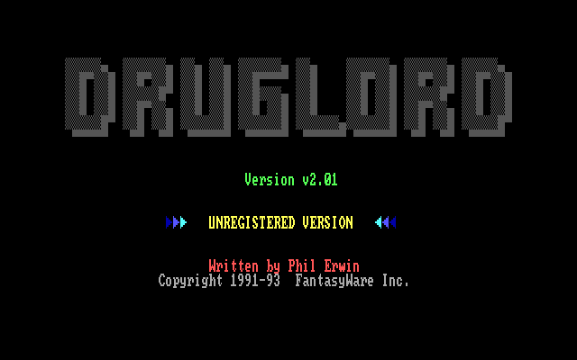

# DrugLord (DOS v2.01), byte-matched C source

A commented C reconstruction of **DRUGLORD.EXE v2.01** by Phil Erwin (FantasyWare Inc., 1991-93).
Compiled with **Borland Turbo C 2.01** in the small memory model, it produces an EXE that is
**byte-for-byte identical** to the original (74,286 bytes, MD5 `1ea0bd4c15546a1dc44365e80fb4b7cf`).

Everything is in [`c/`](c/): the source, the build and verification scripts, and
[`c/README.md`](c/README.md) with the compiler details and how to compile and verify it yourself.

The source also carries a written-out description of the game's rules and formulas ("GAME RULES AND FORMULAS" in
`c/DRUGLORD.C`) and a list of the original's bugs, documented but deliberately not fixed so the match stays exact.

## Other versions

This repository is only the byte-matched C source. The ports live in their own repositories:

- **[druglord-ports](https://github.com/justz00t/druglord-ports)**: Windows exe (v2.10), browser version (WebAssembly) and PowerShell edition.
- **[druglord-nes](https://github.com/justz00t/druglord-nes)**: a separate NES port (ROM and source).
